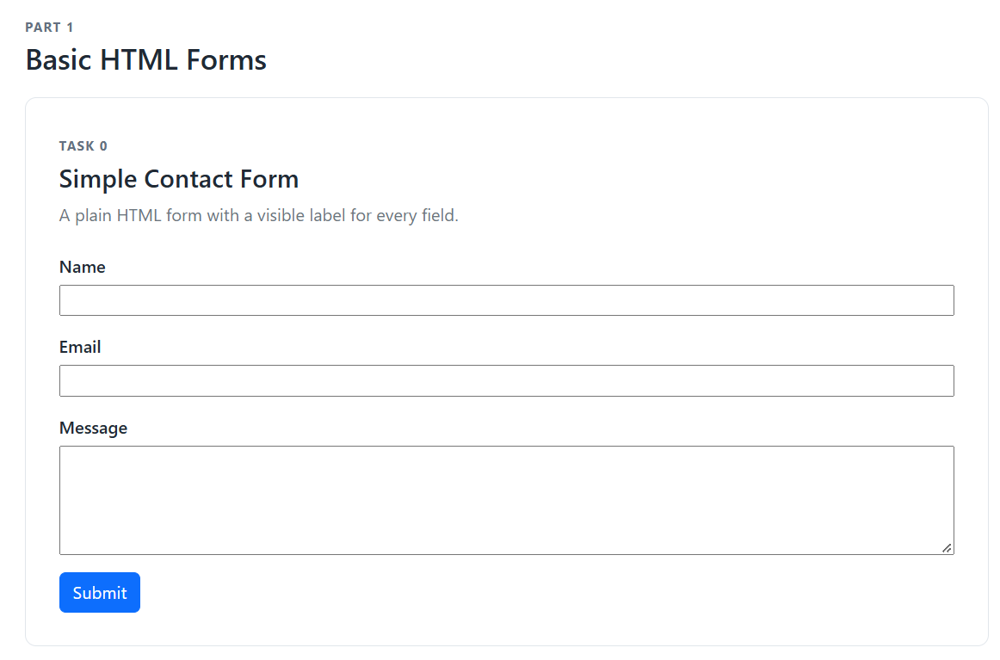
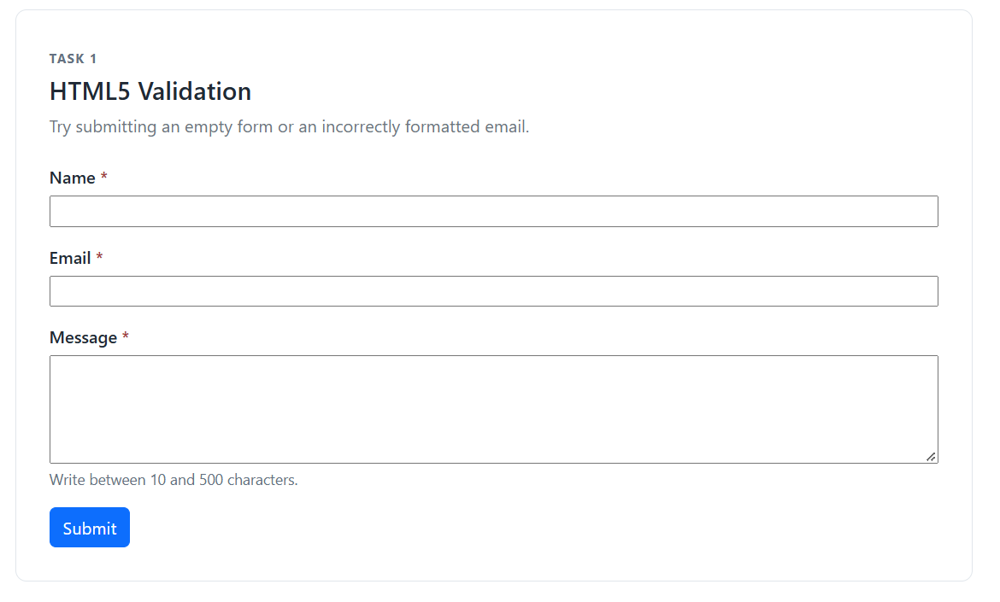
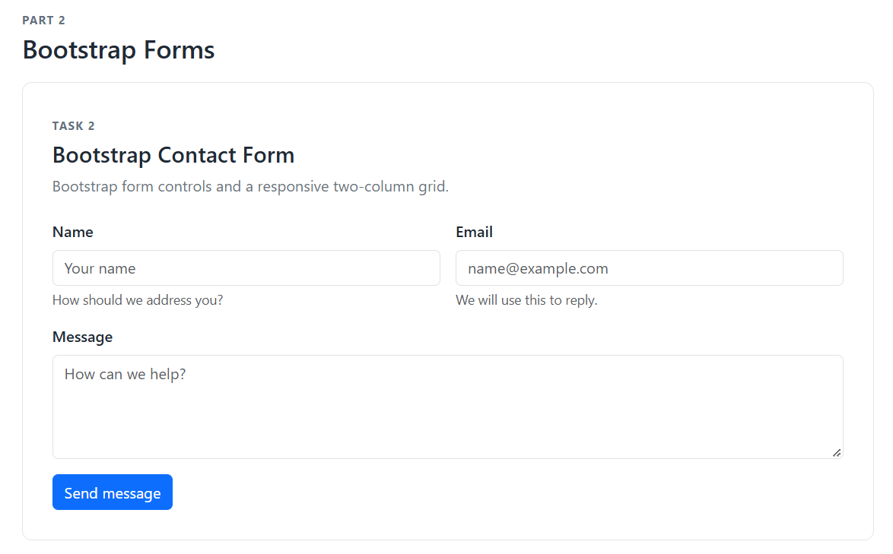
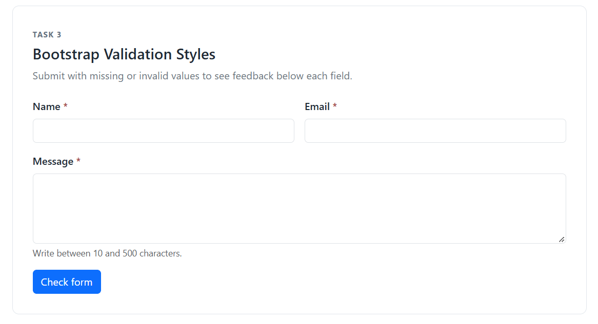
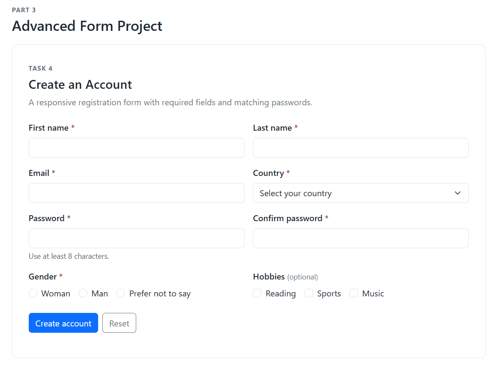

# Assignment 4: Forms and Validation

## Assignment tasks

### Part 1 — Basic HTML Forms

#### Task 0 — Simple Contact Form

The form has labeled name, email, and message fields with a submit button.

#### Task 1 — HTML5 Validation

The form uses `required`, `type="email"`, `minlength`, and `maxlength`. The browser blocks an empty or incorrectly formatted submission and displays its built-in validation message.

### Part 2 — Bootstrap Forms

#### Task 2 — Bootstrap Form Styling

The contact form uses Bootstrap form classes and a responsive grid. Placeholders and short helper messages guide the user.

#### Task 3 — Bootstrap Validation Styles

The form displays Bootstrap `is-invalid` and `is-valid` states with feedback messages below fields. Submit an empty form to see errors; enter valid values to see success messages.

### Part 3 — Advanced Form Project

#### Task 4 — Registration Form

The responsive registration form includes first and last name, email, password confirmation, gender radios, optional hobby checkboxes, and a country dropdown. Passwords must match and be at least eight characters. Submit displays validation feedback; Reset clears the form.

## Work summary

I built the forms in semantic HTML, added HTML5 validation attributes, and used Bootstrap 5 form and grid classes for styling. JavaScript adds field-level Bootstrap feedback, checks that the password fields match, and provides a local demo success message. The forms do not send information to a server.

## How to run

Open `index.html` in a browser. An internet connection is needed to load the Bootstrap stylesheet from the official CDN.

## References

- [Bootstrap 5.3 forms](https://getbootstrap.com/docs/5.3/forms/overview/)
- [Bootstrap 5.3 validation](https://getbootstrap.com/docs/5.3/forms/validation/)
- [MDN: Forms](https://developer.mozilla.org/en-US/docs/Learn_web_development/Extensions/Forms)

## Walkthrough notes

- `required`, `type="email"`, `minlength`, and `maxlength` provide built-in browser checks.
- Bootstrap's grid classes (`row`, `col-md-6`, and `col-12`) rearrange fields for smaller screens.
- `is-invalid` and `is-valid` show field state; feedback text explains what needs attention.
- `setCustomValidity()` checks that the confirmation password matches the original password.
