# Assignment 5: JavaScript Basics

## Student

- Name: **Aben Aibar**
- Group: **IT-2504**

## Part 1: Profile Object, Data Types, and Arithmetic

**Task 1 — Personal Info Object.** The `userProfile` object stores a name (`string`), birth year (`number`), developer status (`boolean`), and hobbies (`array`).

**Task 2 — Arithmetic Calculations.** The page calculates age from the current year and displays the number of hobbies. The profile and calculations are also logged to the browser console.

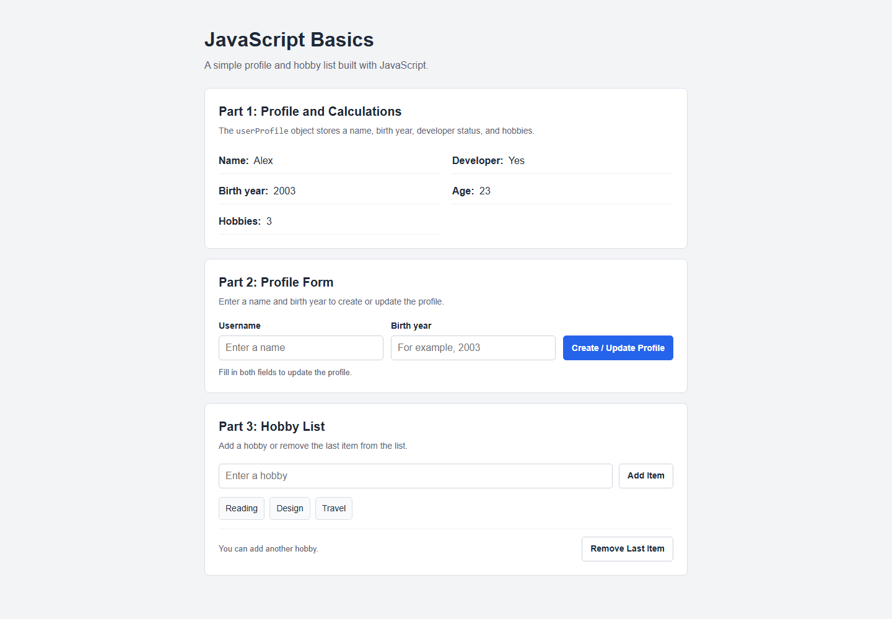

## Part 2: Form Input and Events

**Task 3 — HTML Form Setup.** The form has fields for a username and birth year, plus a Create / Update Profile button.

**Task 4 — Event Listener.** Submitting the form validates the values, updates `userProfile`, and refreshes the profile on the page. The screenshot uses sample data.

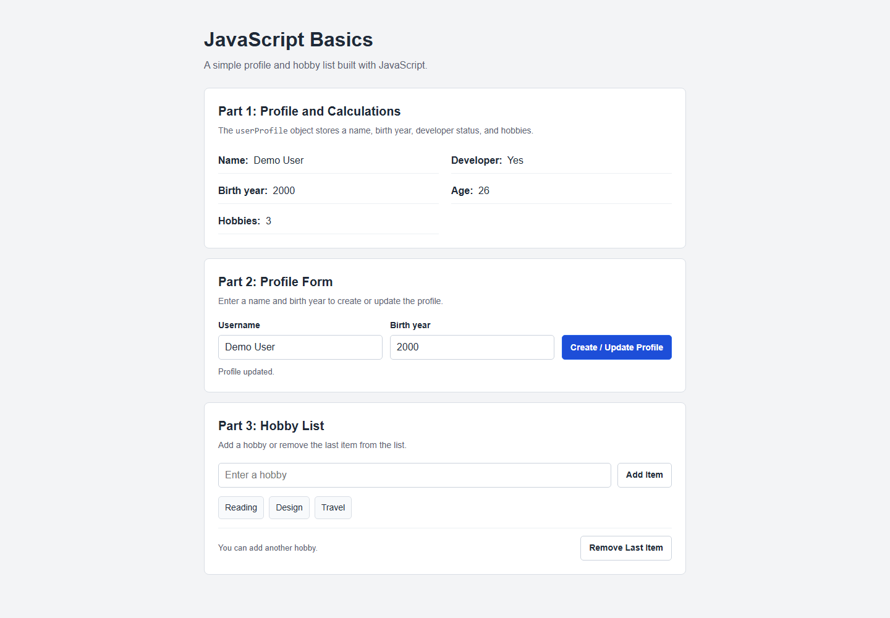

## Part 3: DOM List Manipulation

**Task 5 — Creating and Removing Elements.** The Add Item button adds a new `<li>` to the list. Remove Last Item deletes the last entry. The profile and hobby count update with the list.

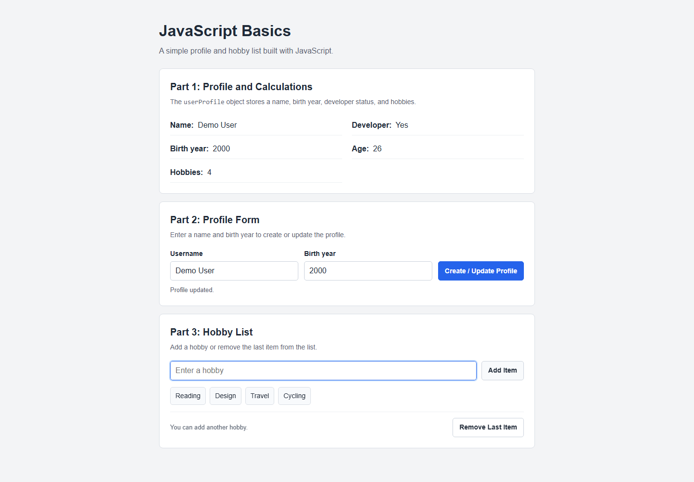

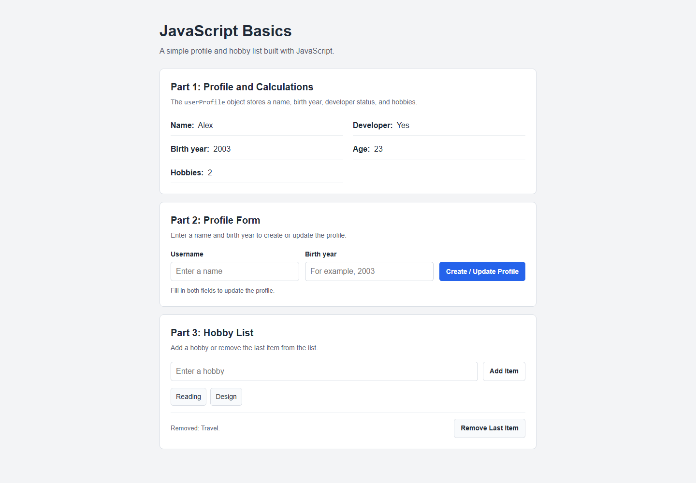

## Work Summary

Built a simple page with HTML and CSS. JavaScript handles the profile object, age calculation, form submission, and dynamic list updates. Open `index.html` in a browser to run the project.

## GitHub Pages

Upload all project files to a public GitHub repository. In the repository settings, enable GitHub Pages from the `main` branch and the root folder (`/`). Submit both the repository link and the GitHub Pages link.

---

# Assignment 6: jQuery Portfolio

**Name:** Aben Aibar  
**Group:** IT-2504

## Assignment tasks

### Part 1 — Getting Started with jQuery

#### Task 0 — Setup

The page loads jQuery 3.7.1 from the official CDN. A `$(document).ready(function () { ... })` callback prints `jQuery is ready!` in the browser console.

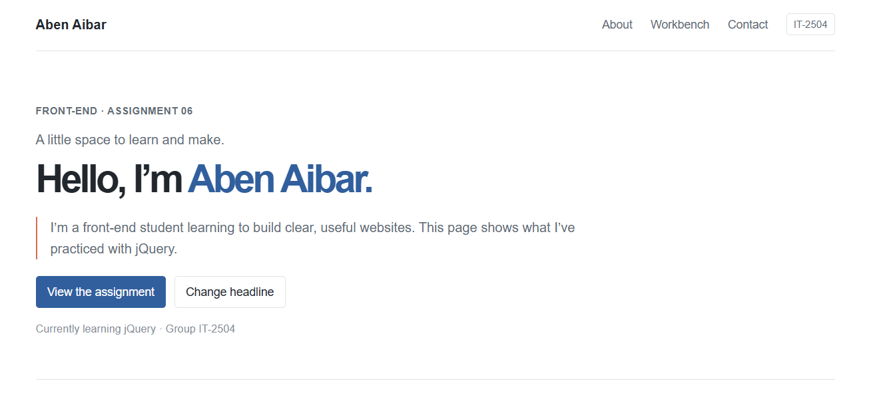

#### Task 1 — Selectors and CSS

The profile shows the student's name, group, introduction, and a changeable headline. The script uses tag, ID, and class selectors, `.text()`, `.html()`, and `.css()`. Light and dark theme buttons change the page colors.

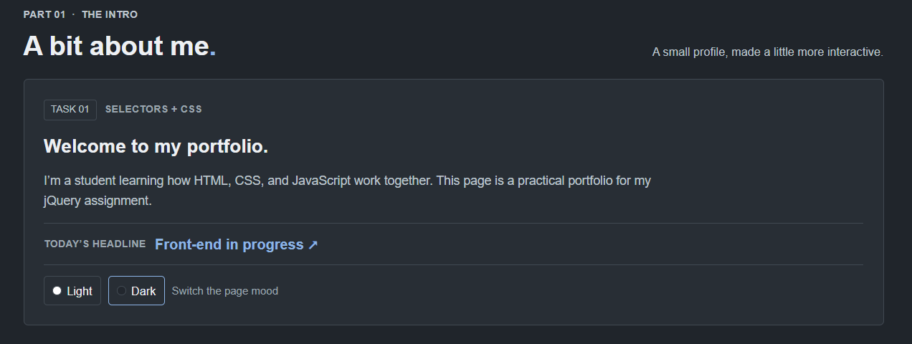

### Part 2 — jQuery Effects

#### Task 2 — Visibility Methods

The About Me card includes a biography, current learning status, and three study facts. Hide, Show, and Toggle control the same content with `.hide()`, `.show()`, and `.toggle()`.

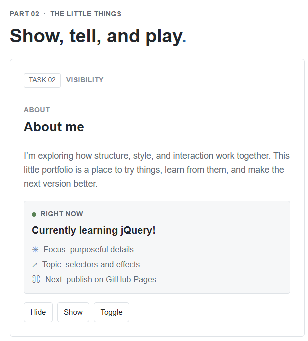

#### Task 3 — Fade Methods

The visual notebook contains two local SVG images. The controls demonstrate `.fadeIn()`, `.fadeOut()`, and `.fadeToggle()`.

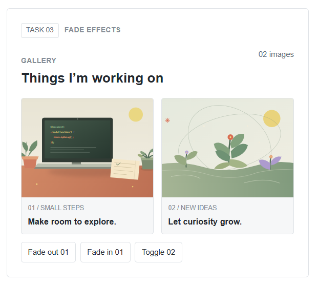

#### Task 4 — Slide Methods

Three clickable headings reveal sample notes for music, movies, and a subject. Each heading uses `.slideToggle()`; Open all and Close all use `.slideDown()` and `.slideUp()`.

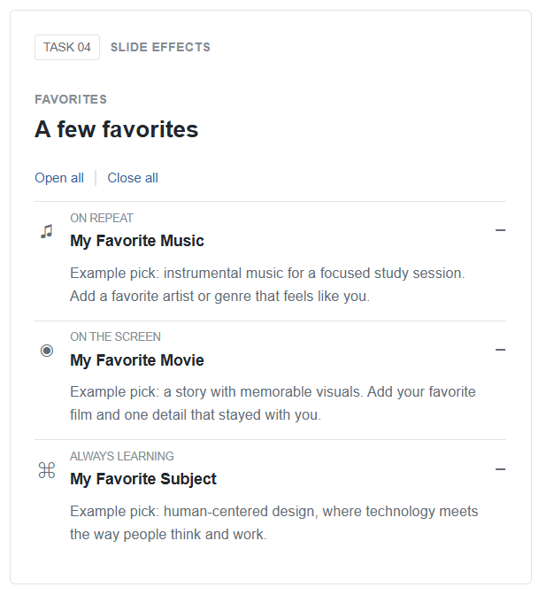

### Part 3 — DOM Manipulation with jQuery

#### Task 5 — Add and Remove Elements

The skills list starts with four technical skills. Add Skill and Prepend Skill insert non-empty input with `.append()` and `.prepend()`; Remove Skill deletes the last item with `.remove()`.

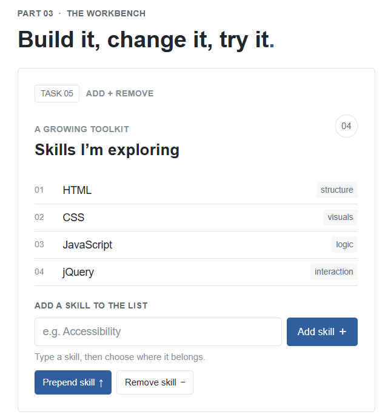

#### Task 6 — Modifying Attributes

The GitHub link button switches its destination between the project and the profile using `.attr()`.

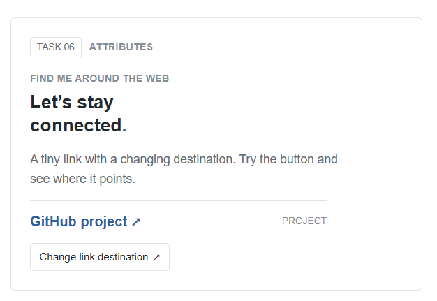

#### Task 7 — Form Interaction

The Name and Email fields update the preview as the visitor types. The script reads values with `.val()` and writes the preview with `.text()`.

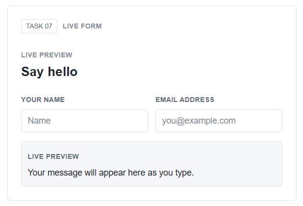

### Part 4 — Animations

#### Task 8 — Basic Animation

Three skill bars start at zero width. Animate My Skills uses `.animate()` to move each bar to a different target; pressing it again returns all bars to zero.

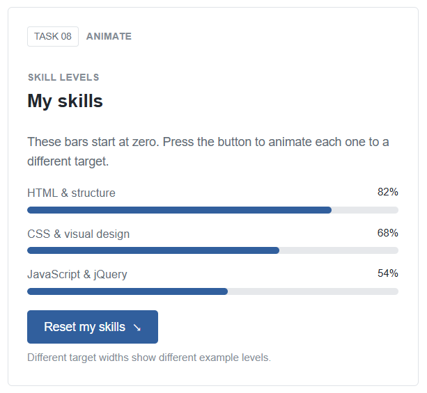

## Work summary

I built a responsive portfolio page and used jQuery selectors, DOM updates, visibility and fade effects, slide panels, list editing, attribute changes, live form feedback, and animated skill bars. The page uses local SVG illustrations; the interactions run in the browser and do not send form data to a server. Sample favorite descriptions are labeled as examples and can be replaced with personal choices.

## How to run

Open `assignment6/index.html` in a browser. An internet connection is needed to load jQuery from the official CDN. The illustrations are stored locally in `assignment6/assets/`.

## References

- [jQuery API](https://api.jquery.com/)
- [jQuery Effects](https://api.jquery.com/category/effects/)
- [W3Schools: jQuery Effects](https://www.w3schools.com/jquery/jquery_ref_effects.asp)
- [MDN: ARIA live regions](https://developer.mozilla.org/en-US/docs/Web/Accessibility/ARIA/ARIA_Live_Regions)
