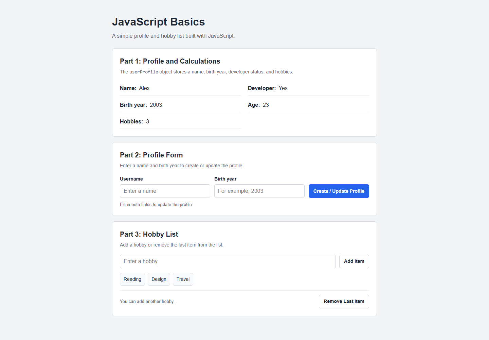
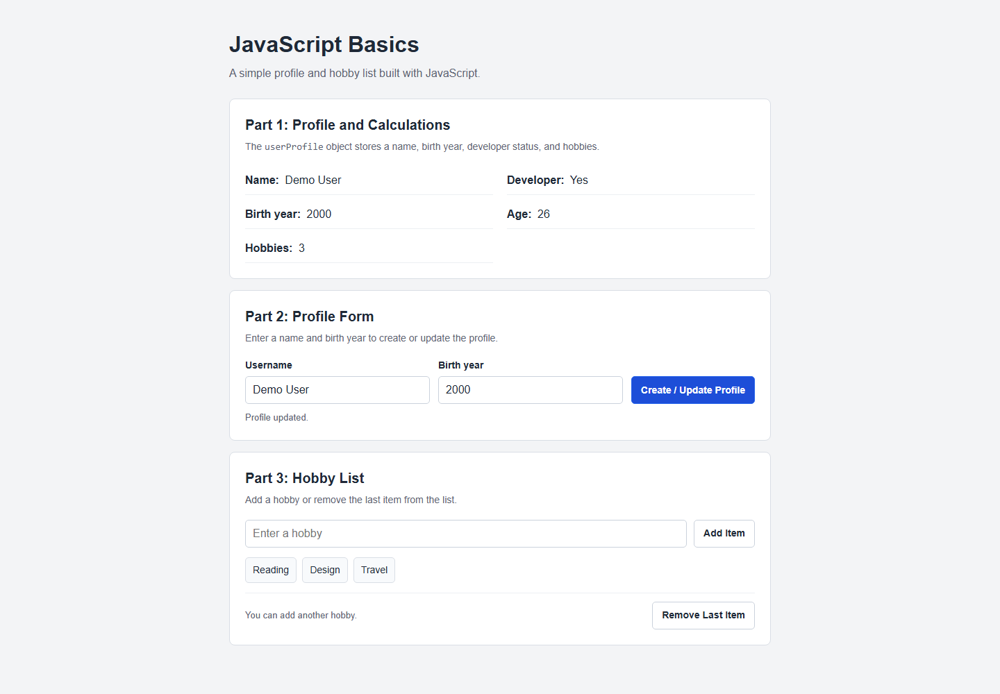
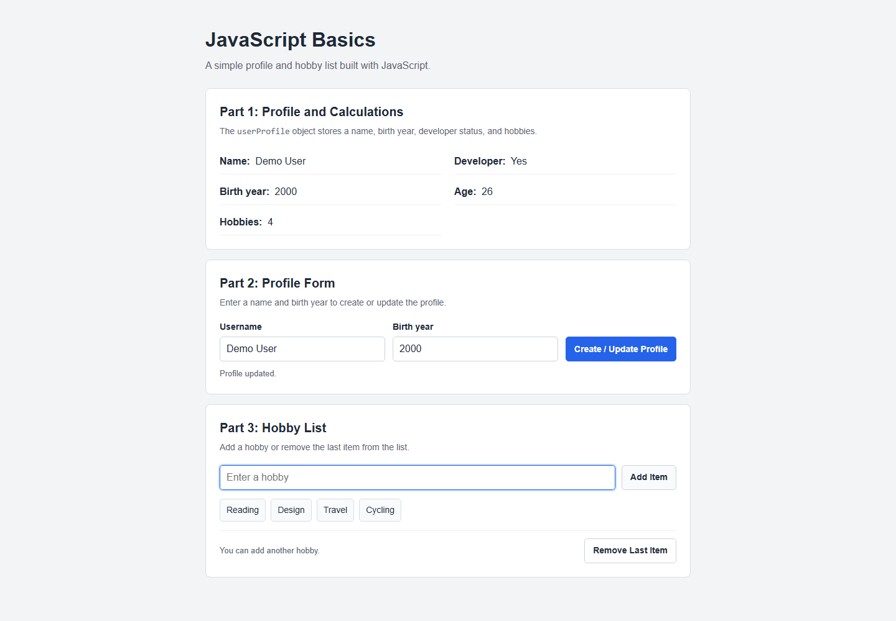
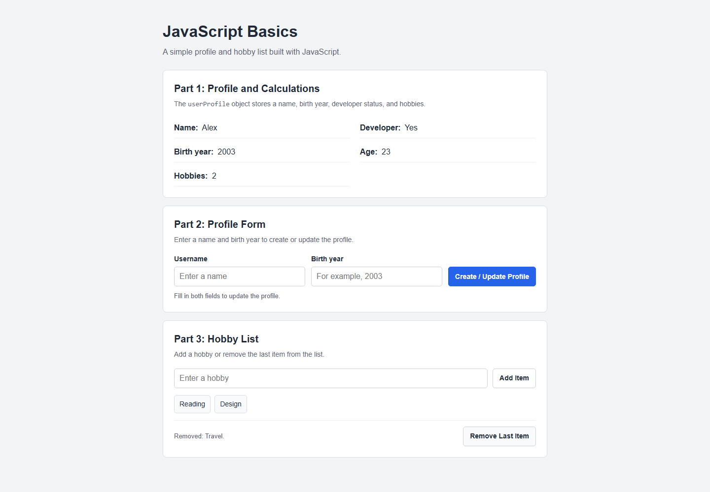

# Assignment 5: JavaScript Basics

## Student

- Name: **Aben Aibar**
- Group: **IT-2504**

## Part 1: Profile Object, Data Types, and Arithmetic

**Task 1 — Personal Info Object.** The `userProfile` object stores a name (`string`), birth year (`number`), developer status (`boolean`), and hobbies (`array`).

**Task 2 — Arithmetic Calculations.** The page calculates age from the current year and displays the number of hobbies. The profile and calculations are also logged to the browser console.

## Part 2: Form Input and Events

**Task 3 — HTML Form Setup.** The form has fields for a username and birth year, plus a Create / Update Profile button.

**Task 4 — Event Listener.** Submitting the form validates the values, updates `userProfile`, and refreshes the profile on the page. The screenshot uses sample data.

## Part 3: DOM List Manipulation

**Task 5 — Creating and Removing Elements.** The Add Item button adds a new `<li>` to the list. Remove Last Item deletes the last entry. The profile and hobby count update with the list.

## Work Summary

Built a simple page with HTML and CSS. JavaScript handles the profile object, age calculation, form submission, and dynamic list updates. Open `index.html` in a browser to run the project.

## GitHub Pages

Upload all project files to a public GitHub repository. In the repository settings, enable GitHub Pages from the `main` branch and the root folder (`/`). Submit both the repository link and the GitHub Pages link.
